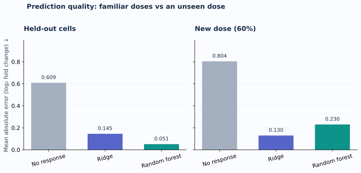
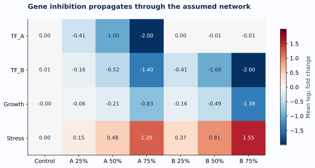
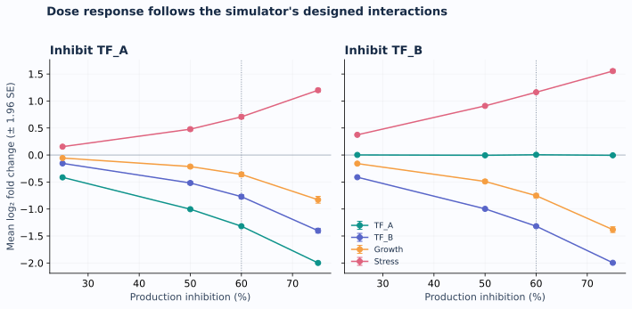
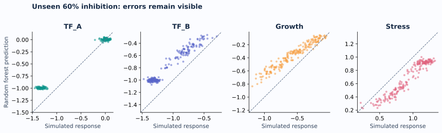

<!DOCTYPE html>
<html lang="en">
<head>
<meta charset="utf-8"><meta name="viewport" content="width=device-width, initial-scale=1">
<title>Shichuan Cheng | Data Science Portfolio</title>
<meta name="description" content="A reproducible virtual-cell sandbox: simulated gene perturbations, transparent models, and honest evaluation.">
<link rel="stylesheet" href="assets/style.css">
</head>
<body>
<header class="nav wrap"><a class="brand" href="#home"> SC / DATA SCIENCE</a><nav aria-label="Main"><a href="#project">Project</a><a href="#findings">Findings</a><a href="#about">About</a><a href="https://github.com/HenryCHENG666/data-science-project">GitHub ↗</a></nav></header>
<main id="home">
<section class="hero wrap">

BIOLOGY, EXPLORED THROUGH DATA
<h1>Small models. Clear questions. <em>Cellular possibilities.</em></h1>
I'm Shichuan Cheng, an MSc student in Data Science (Precision Medicine) at the University of Macau. I explore how transparent simulations and machine learning can help us ask better questions about cells.

<a class="button" href="#project">Explore the project ↓</a><a class="text-link" href="https://github.com/HenryCHENG666">GitHub profile ↗</a>

CISC7204 · Practice 09 · October 2026

<svg viewBox="0 0 500 500" xmlns="http://www.w3.org/2000/svg"><defs><radialGradient id="halo"><stop stop-color="#98e9df" stop-opacity=".5"/><stop offset="1" stop-color="#d5f0ed" stop-opacity="0"/></radialGradient><linearGradient id="membrane" x2="1" y2="1"><stop stop-color="#e0faf4"/><stop offset="1" stop-color="#c3d7f2"/></linearGradient></defs><circle cx="250" cy="250" r="245" fill="url(#halo)"/><path d="M245 68C343 55 423 126 427 229S383 409 275 425 74 363 68 262 143 81 245 68Z" fill="url(#membrane)" stroke="#6cb7b0" stroke-width="1.5"/><path d="M239 87C325 77 401 137 405 230S367 386 274 403 99 352 91 264 152 100 239 87Z" fill="none" stroke="#fff" stroke-width="2" stroke-dasharray="3 7"/><circle cx="250" cy="250" r="92" fill="#f7fbff" fill-opacity=".9" stroke="#9baed4"/><ellipse cx="250" cy="250" rx="62" ry="89" fill="none" stroke="#d7deef" transform="rotate(35 250 250)"/><path d="M145 178L237 241L336 179M237 241L326 325" stroke="#687dc0" stroke-width="3" fill="none"/><circle cx="145" cy="178" r="30" fill="#0e938b"/><circle cx="237" cy="241" r="33" fill="#5865c8"/><circle cx="336" cy="179" r="30" fill="#f59e42"/><circle cx="326" cy="325" r="30" fill="#df637e"/><g fill="white" font-family="system-ui,sans-serif" font-size="14" text-anchor="middle" font-weight="600"><text x="145" y="183">TF_A</text><text x="237" y="246">TF_B</text><text x="336" y="184">Growth</text><text x="326" y="330">Stress</text></g><g fill="#5ca49e" opacity=".35"><circle cx="153" cy="308" r="9"/><circle cx="184" cy="359" r="5"/><circle cx="357" cy="265" r="7"/><circle cx="294" cy="128" r="6"/><circle cx="124" cy="238" r="4"/><circle cx="214" cy="126" r="4"/></g></svg>
VIRTUAL CELL / SYNTHETIC SANDBOX

</section>
<section class="metrics wrap" aria-label="Project at a glance">
<strong>400</strong>synthetic cell identities

<strong>4</strong>hypothetical genes

<strong>3,600</strong>simulated observations

<strong>6</strong>reproducible visualizations
</section>
<section id="project" class="section wrap">

01 / FEATURED PROJECT
● Completed educational prototype
<h2>Virtual Cell Sandbox</h2>
Can a small model predict gene-inhibition responses—and handle a dose it has never seen?

<b>THE QUESTION</b>
Can simple models predict a simulated cell response?

<b>THE FINDING</b>
Random forest wins at familiar doses; Ridge wins at an unseen 60% dose.

<b>THE LIMITATION</b>
Synthetic cells only. Real biological validity has not been tested.

<h3>The idea</h3>
A virtual cell is a computational representation used to explore cellular behavior. Here, a four-gene simulator generates paired baseline and treated cells. Ridge regression and a random forest learn to predict expression changes after inhibition.

Every test cell is held out from training. A separate 60% inhibition test asks a harder question: does the model interpolate to an unseen dose?

Pythonpandasscikit-learnMatplotlibGrouped evaluation
<a class="text-link" href="https://github.com/HenryCHENG666/data-science-project">View code, data &amp; reproducibility instructions ↗</a>

SCOPE &amp; DATA PERMISSIONS<h3>A learning model, with explicit boundaries.</h3>
All data are generated by the included simulator. Genes, interactions and parameters are hypothetical; Growth and Stress are gene labels. These results are not evidence about real cells or drug efficacy.

Code, synthetic data and original figures are available under the MIT license. No personal or restricted data are used.

</section>
<section id="findings" class="section tinted">

02 / WHAT THE RESULTS SHOW
<h2>A better familiar-dose score doesn't guarantee a better new-dose model.</h2>
Random forest wins on familiar doses. Ridge wins at the unseen 60% dose. Error is measured in log₂ fold-change units; lower is better.
<figure class="figure"><figcaption>Same 100 held-out cell identities, two evaluation settings. One fixed seed and split; no hyperparameter search.</figcaption></figure>
<table><caption>Prediction error at a glance — lower MAE is better</caption><thead><tr><th scope="col">Evaluation</th><th scope="col">Ridge</th><th scope="col">Random forest</th><th scope="col">Lower error</th></tr></thead><tbody><tr><th scope="row">Familiar doses</th><td>0.145</td><td>0.051</td><td>Random forest</td></tr><tr><th scope="row">Unseen 60% dose</th><td>0.130</td><td>0.230</td><td>Ridge</td></tr></tbody></table>

<article>01<h3>Interventions propagate.</h3>
Inhibiting B lowers Growth and raises Stress, as built into the equations. This checks the simulation; it does not discover a biological mechanism.
</article><article>02<h3>Evaluation changes the story.</h3>
Random forest MAE is 0.051 at familiar doses, but 0.230 at 60%. Ridge achieves 0.130 at 60%, about 44% lower.
</article><article>03<h3>Boundaries matter.</h3>
All results come from one assumed simulator. Testing on real perturbation data and repeating grouped splits are essential next steps.
</article>

</section>
<section class="section wrap">
03 / EXPLORE THE RESPONSE
<h2>Change the intervention. Watch the assumed network respond.</h2>
Select a simulated condition. Bars show mean gene-expression change across the 100 test cells. These are precomputed simulator results, not live model predictions.

<label for="condition">Intervention</label><select id="condition"><option value="Control">Control — no inhibition</option><option value="A_0.25">Inhibit TF_A by 25%</option><option value="A_0.5">Inhibit TF_A by 50%</option><option value="A_0.75">Inhibit TF_A by 75%</option><option value="B_0.25">Inhibit TF_B by 25%</option><option value="B_0.5">Inhibit TF_B by 50%</option><option value="B_0.75">Inhibit TF_B by 75%</option></select>
Percent inhibition reduces simulated gene production; it is not a real drug dose.  Zero = no change. −1 = half the baseline expression. +1 = twice the baseline expression.

<noscript>
The explorer needs JavaScript; the full response heatmap below remains available.
</noscript><figure class="figure"><figcaption>Measured control values are near zero because independent measurement noise is included.</figcaption></figure></section>
<section class="section wrap">
04 / THE WORKFLOW
<h2>Reproducible from the first cell to the final figure.</h2>
<article><b>1 / Simulate</b>
Four assumed equations. Fixed seed. Paired baseline and intervention data.
</article><article><b>2 / Separate</b>
300 train cells, 100 test cells. No identities cross the split.
</article><article><b>3 / Compare</b>
No-response baseline, Ridge, random forest. Familiar and unseen doses.
</article><article><b>4 / Inspect</b>
Metrics, prediction errors, dose curves and readable limitations.
</article>

<figure class="figure"><figcaption>Dose response follows the simulator's designed network.</figcaption></figure><figure class="figure"><figcaption>Prediction plots expose errors that one summary score can hide.</figcaption></figure>

<code>python -m pip install -r requirements.txt python src/analyze.py python -m unittest discover -s tests -v</code><a class="text-link" href="https://github.com/HenryCHENG666/data-science-project/blob/main/notebooks/virtual_cell_analysis.ipynb">Read the executed notebook ↗</a>
</section>
<section id="about" class="section dark">

05 / ABOUT ME
<h2>From economic statistics to computational biology.</h2>
I have a background in Economic Statistics and am developing my skills in data science for precision medicine. My interests include virtual cells, single-cell data analysis and AI for biology.

This portfolio demonstrates reproducible programming, model comparison, visualization and careful interpretation. It is a starting point for learning to work with real biological data.

PythonRStatisticsData visualizationMachine learningGit &amp; GitHub

<h3>What I will improve next</h3>
Repeat the evaluation across several seeds, introduce a separate validation split, and investigate a suitably licensed real perturbation dataset with biological replicates.

<strong>Main limitation:</strong> performance on synthetic cells does not establish biological validity.

AI-simulated reader review led to the quick-read summary and numerical table above. The course-required real classmate review remains pending.
<a class="text-link" href="https://doi.org/10.1016/j.cell.2024.11.015">Background: the AI virtual-cell vision ↗</a>

</section>
</main><footer class="wrap footer">Shichuan Cheng · CISC7204 Practice 09 · 2026Original figures · Synthetic data · MIT license Built with AI assistance through OpenAI Codex. Numerical results were generated by the included code.</footer></body></html>
